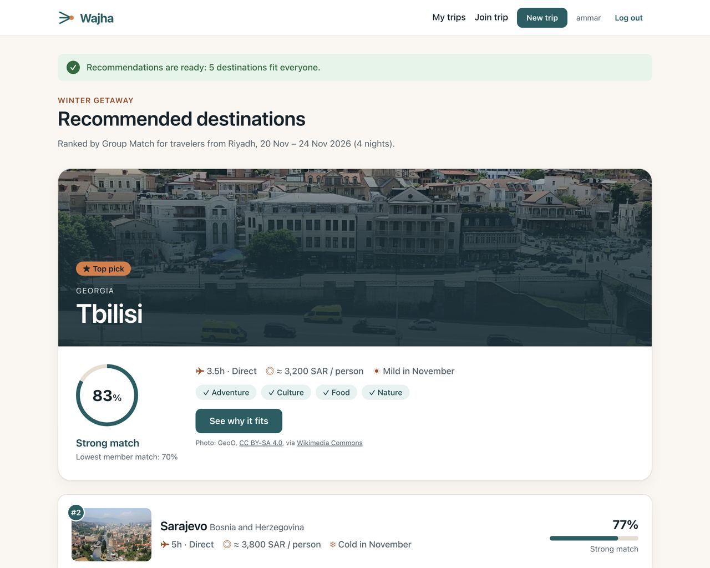

# Wajha

**Everyone has a preference. Wajha finds the destination everyone can agree on.**

Wajha is a Django web application that helps a group of friends in Saudi Arabia decide **where** to travel together. Each member privately enters their budget, maximum flight time, weather preference and interests. Wajha excludes destinations that break anyone's limits, ranks the rest with a fairness-weighted **Group Match** score, explains why each one fits, and lets the organizer save the final decision.



## The problem and the audience

**Target users:** groups of 2–8 friends departing from Saudi Arabia (Riyadh, Jeddah or Dammam) who are planning an international leisure trip together.

**Problem:** every friend has different constraints: a different budget, a maximum acceptable flight, a need for direct flights, a preferred climate, different interests. The decision usually happens in a long group chat where budgets stay unspoken and one person's limits get overlooked.

**Why Wajha instead of a group chat or poll:** constraints are collected privately; destinations that break any member's limit are excluded; the ranking uses a fairness rule so one unhappy member isn't averaged away; and every result explains itself. Market assumptions and the plan for testing them are in [docs/market.md](docs/market.md).

## Core features

- **Accounts:** register, log in and log out with Django's authentication (passwords are hashed by Django).
- **Trips:** create a trip with a departure city and dates. Each trip gets a readable invite code such as `WJ-8K32L`.
- **Join by code:** case-insensitive, with or without the `WJ-` prefix. Duplicate joins, unknown codes, full trips (8 members) and closed trips are rejected with clear messages.
- **Private preferences per trip:** budget (SAR, for the whole trip), maximum flight time, weather, direct-only and interests.
- **Readiness:** a segmented progress bar. Recommendations unlock when there are at least 2 members and all of them have submitted.
- **Recommendations:**
  - a deterministic matching engine ranks destinations
  - a "Didn't fit everyone" section shows reasons without naming members
- **Explanation page:** plain-language reasons, a breakdown by factor and each member's compatibility.
- **Decision:** the organizer confirms the final destination. The trip becomes **Decided**, is locked, and shows a boarding-pass card.
- **Organizer tools:** edit the trip, remove a member, cancel the trip. Each needs confirmation and is enforced on the server.
- **Reports:**
  - a group summary (lowest and average budget, shortest maximum flight, top interests)
  - My Trips with status filters and per-trip member/ready counts
- **Polished, responsive interface:**
  - custom design system with the bundled Readex Pro font
  - freely licensed destination photos with alt text
  - custom 404/403 pages
  - WCAG AA colour contrast

### How matching works

1. **Estimated cost per person** = return flight + daily on-ground cost × nights.
   - `estimated_daily_cost` is an illustrative per-person estimate of accommodation, food and local transport. **All prices are illustrative estimates, not live prices.**
2. **Hard constraints:** a destination is excluded if it costs more than any member's budget, has a longer flight than any member's maximum, or has no direct flight when a member needs one.
3. **Member score (0–100):** interests 35, budget comfort 25, weather (for the trip's month) 20, flight comfort 15, direct flight 5.
4. **Group Match** = 0.7 × average member score + 0.3 × lowest member score.
5. **Ties** are broken by lowest member score, then lower cost, then shorter flight, then city name.

The engine is pure Python with no database access ([trips/services/matching.py](trips/services/matching.py)). A worked example is in [docs/verification.md](docs/verification.md#hand-calculation-for-v17-tbilisi-winter-getaway).

## Technology

| | Version |
|---|---|
| Python | 3.14.7 (Django 6.1 requires Python 3.12 or newer) |
| Django | 6.1.2 |
| Database | SQLite (Django's default; managed through models and migrations) |
| Other packages | `python-dotenv` 1.2.4 (reads `.env`); see [requirements.txt](requirements.txt) |

There are no external APIs and no CSS or JavaScript frameworks. The app works fully offline.

## Setup

macOS / Linux:

```bash
git clone <repository-url> wajha
cd wajha
python3 -m venv venv
source venv/bin/activate
pip install -r requirements.txt
cp .env.example .env
```

Windows (PowerShell):

```powershell
git clone <repository-url> wajha
cd wajha
py -m venv venv
venv\Scripts\Activate.ps1
pip install -r requirements.txt
copy .env.example .env
```

Then:

1. **Generate a secret key** and paste it into `.env` as `DJANGO_SECRET_KEY`:
   ```bash
   python -c "from django.core.management.utils import get_random_secret_key; print(get_random_secret_key())"
   ```
2. **Create the database and load the sample data:**
   ```bash
   python manage.py migrate
   python manage.py load_demo_data
   ```
3. **Start the server** and open <http://127.0.0.1:8000/>:
   ```bash
   python manage.py runserver
   ```

Optional: `python manage.py createsuperuser` gives access to the admin at `/admin/` (catalog, trips and members).

### Configuration (`.env`)

| Variable | Required | Example | Purpose |
|---|---|---|---|
| `DJANGO_SECRET_KEY` | Yes | a long random string | Django's secret key. Never commit it; the app refuses to start without it |
| `DJANGO_DEBUG` | No (default `False`) | `True` | `True` for local development |
| `DJANGO_ALLOWED_HOSTS` | No (default `localhost,127.0.0.1`) | `localhost,127.0.0.1` | Hosts the app may serve |

`.env` is ignored by Git; [.env.example](.env.example) documents the settings safely.

**Custom error pages** only appear with `DJANGO_DEBUG=False`. To see them locally, run `python manage.py runserver --insecure`, which lets the development server still serve static files.

## Sample data and demo accounts

`python manage.py load_demo_data` loads:

- **Catalog:** 3 departure cities, 7 interests, 12 destinations, 36 routes (one per city pair) and 48 climate rows (one per destination per three-month period).
- **Five fictitious demo accounts:** `ammar`, `faisal`, `mohammed`, `khalid` and `sara`. Every account uses the password **`wajha-demo-2026`**. These are demo-only credentials for invented users.
- **Five demo trips in every state:**

| Trip | Organizer | State |
|---|---|---|
| Winter Getaway (RUH, Jan 2027) | ammar | 4/4 ready, recommendations generated (Tbilisi 87.7%) |
| Spring Break (JED, Mar 2027) | ammar | 2 of 3 ready (khalid waiting) |
| Summer Escape (RUH, Jul 2027) | faisal | Decided: Sarajevo |
| Eid Trip (RUH, Mar 2027) | ammar | Cancelled |
| Weekend on a Budget (RUH, Feb 2027) | ammar | Ready, but no destination fits everyone |

Run the command again at any time to reset the demo trips. It never modifies an existing account that isn't a demo account. Use `--catalog-only` to load destinations without demo accounts.

## Tests

```bash
python manage.py test
```

There are 206 automated tests covering business rules, permissions, validation, the matching calculations (with hand-calculated expected values), reports and the demo data. Manual acceptance scenarios and results are in [docs/verification.md](docs/verification.md).

## Project structure

```
config/          settings (reads .env), root URLs
accounts/        registration, login, logout
destinations/    catalog: OriginCity, Destination, DestinationClimate, Interest, RouteProfile,
                 catalog data and loader, bundled photo credits
trips/           Trip, TripMember, Preference, Recommendation; views, forms, permissions
  services/      trip_actions.py (create, join, preferences, finalize, cancel, edit, remove)
                 matching.py (pure scoring engine) · recommendations.py (DB ↔ engine)
                 summary.py (group summary report)
  demo.py        fictitious demo accounts and trips
  management/    load_demo_data command
  tests/         automated tests
templates/       base layout, partials, pages, error pages
static/          css/style.css (design system), js/app.js (copy button),
                 fonts/ (Readex Pro + licence), img/destinations/ (photos)
docs/            ERD, verification record, demo script, market validation, screenshots
```

### Where the required ORM features appear

| Capability | Where in the app |
|---|---|
| CRUD | Trip: create / edit / cancel (retire) · TripMember: join / remove · Preference: create / update (deleted with its member) · Recommendation: generate / clear |
| Filtering and ordering | My Trips status filter, newest first · recommendations by rank · active destinations only |
| Relationship queries | My Trips (trips through memberships) · destinations through routes from the departure city · group summary through Preference → TripMember → Trip |
| Aggregation | Trip Room group summary (`Avg`, `Min`, `Count`) · readiness counts · My Trips status counts |
| Annotation | My Trips member and ready counts per trip · top interests with vote counts |

## Documentation

- [docs/erd.md](docs/erd.md): final ERD, constraints, deletion behaviour and design reasoning
- [docs/verification.md](docs/verification.md): acceptance scenarios, results, test summary, known limitations
- [docs/demo.md](docs/demo.md): demo script and technical discussion notes
- [docs/market.md](docs/market.md): market validation: assumptions, survey, competitors, revenue model

## Known limitations

- Prices, flight times and weather are illustrative, not live.
- There are no notifications.
- Members can't leave a trip on their own; the organizer can remove them.
- Budget privacy is partial in small groups.

The full list is in [docs/verification.md](docs/verification.md#known-limitations).

## Credits and acknowledgements

- **AI assistance:** this project was built with significant help from **Claude (Anthropic)**, an AI assistant used for planning, writing and reviewing code, tests and documentation. All work was reviewed, run and verified, and I can explain every part of the implementation.
- **Destination photos:** 12 freely licensed photos from Wikimedia Commons (CC BY, CC BY-SA or public domain), resized and converted to WebP. Each author and licence is listed on the in-app **Credits** page (`/credits/`, linked in the footer) and in [destinations/photos.py](destinations/photos.py).
- **Font:** [Readex Pro](https://github.com/ThomasJockin/readexpro) by The Readex Pro Project Authors, under the SIL Open Font License 1.1 ([static/fonts/OFL.txt](static/fonts/OFL.txt)).
- **Framework:** [Django](https://www.djangoproject.com/) and its documentation.
