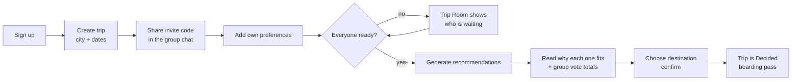
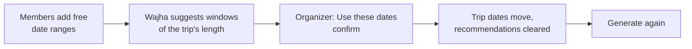

# Wajha — Design: User Journeys, Wireframes and Task List

This document covers the design checkpoint: who uses Wajha, the journeys they take, simple wireframes of the key screens, and the prioritized task list with its status. The data design is in [erd.md](erd.md).

## Roles

| Role | Who | Can view | Can change |
|---|---|---|---|
| Visitor | Not signed in | Landing page, credits, log in, sign up | Create an account |
| Member | Signed in and joined the trip | The Trip Room, group summary, recommendations, explanations, shared dates, vote totals | Their own preferences, their own free dates, their own vote |
| Organizer | The member who created the trip | Everything a member sees | Edit the trip, generate recommendations, apply suggested dates, remove members, choose the destination, cancel the trip |

Every rule is enforced on the server (`trips/permissions.py`): a non-member gets a 404, a member trying an organizer action gets a 403.

## User journeys

### 1. Organizer: from idea to decision (core workflow)



### 2. Member: join and give preferences privately


### 3. Agreeing on dates (optional, before generating)



### 4. Failure paths the interface handles

- Wrong or mistyped invite code → "No trip uses that code" (the code is accepted in lower case, with or without the `WJ-` prefix).
- Joining a full, decided or cancelled trip → refused with the reason.
- Budget below 500 SAR, flight in quarter hours, no interest chosen, end date before start → field errors, nothing saved.
- Nobody fits everyone → an empty state that lists what blocks each destination, without naming members.
- Opening someone else's trip → 404; a member trying organizer actions → 403 page.

## Wireframes

Simple layouts of the screens that carry the workflow. The finished screens are in the README and `docs/img/`. In the Arabic version (`/ar/`) every layout is mirrored right-to-left.

### Landing page

```
+--------------------------------------------------------------+
| [logo] Wajha                          Log in [Sign up] [AR]  |
+--------------------------------------------------------------+
|  Group travel, decided together        +------------------+  |
|  WHERE ARE WE GOING?                   |  postcard stack  |  |
|  Everyone has a preference...          |  Tbilisi  (83%)  |  |
|  [Start planning]  [I have an account] +------------------+  |
|~~~~~~~~~~~ city names scrolling ~~~~~~~~~~~~~~~~~~~~~~~~~~~~~|
|  How it works:  [01 Create] [02 Preferences] [03 Decide]     |
|  The fairness rule: average / lowest / Group Match bars      |
+--------------------------------------------------------------+
```

### My Trips

```
+--------------------------------------------------------------+
| My trips                           [Join with code][New trip]|
| [ search by trip name or destination        ] [Search]       |
| (All 5) (Planning 3) (Decided 1) (Cancelled 1)               |
| +------------+ +------------+ +------------+                 |
| |Planning  4m| |Decided   4m| |Cancelled 2m|                 |
| |Winter Get. | |Summer Esc. | |Eid Trip    |                 |
| |RUH -> ?    | |RUH -> Sar. | |RUH -> ?    |                 |
| |14-18 Jan   | |8-14 Jul    | |8-12 Mar    |                 |
| |4 of 4 ready| |            | |            |                 |
| +------------+ +------------+ +------------+                 |
|               [<- Previous]  Page 1 of 2  [Next ->]          |
+--------------------------------------------------------------+
```

### Trip Room

```
+--------------------------------------------+-----------------+
| BOARDING PASS  [Planning][Organizer]       | INVITE CODE     |
| Winter Getaway                             | WJ-8K32L        |
| RUH  - - - - ✈ - - - -  ???                | ||||||||||||||  |
| Dates | Nights | Travelers                 | [Copy code]     |
+--------------------------------------------+-----------------+
| NEXT STEP                           | WHEN CAN EVERYONE GO?  |
| Recommendations are ready           | 3 of 4 shared dates    |
| Top pick: Tbilisi 88%               | Best: 14-18 Jan        |
| Group vote: 3 of 4 voted            | [Share your dates]     |
| [View recommendations]              +------------------------+
+-------------------------------------+ GROUP SUMMARY          |
| MEMBERS (4 of 8)                    | budget limit | average |
| [runway ✈ 4 of 4 ready]             | max flight   | direct  |
| [A ammar  READY] [F faisal READY]   | Top interests (bars)   |
| [M mohammed ...] [K khalid  ...]    +------------------------+
|  (organizer: Remove buttons)        | ORGANIZER ACTIONS      |
+-------------------------------------+------------------------+
```

### Recommendations

```
+--------------------------------------------------------------+
| Winter Getaway / Recommended destinations                    |
|        [#3]   [#2]   [ #1 Tbilisi 88% ]   (3D coverflow)     |
|                 [<-]  o o o o o  [->]                         |
| +----------------------------------------------------------+ |
| | Top pick: Tbilisi   facts · interests     (88% stamp)     | |
| | [See why it fits] [Choose Tbilisi]        Excellent match | |
| +----------------------------------------------------------+ |
| GROUP VOTE: which of the top 3?               3 of 4 voted   |
| #1 Tbilisi  [=======    ] 2 votes  Leading       [Vote]      |
| #2 Sarajevo [===        ] 1 vote                 [Vote]      |
| #3 Cairo    [           ] 0 votes                [Vote]      |
| FULL RANKING: #1 ... #5 with score bars                      |
| (+) Didn't fit everyone (7): reasons, no names               |
+--------------------------------------------------------------+
```

### Shared dates

```
+------------------------------+-------------------------------+
| YOUR FREE DATES              | BEST DATES FOR THE GROUP      |
| 20 Mar - 5 Apr     [Remove]  | Current: 25-30 Mar  2 of 3    |
| - - - - - - - - - - - - - -  | (1) 27 Mar-1 Apr  Everyone    |
| Free from [    ] until [   ] |     [Use these dates]         |
| [Add dates]  up to 5 ranges  | (2) 20-25 Mar     1 of 3      |
+------------------------------+ (3) 1-6 Apr       1 of 3      |
| WHO HAS SHARED               |                               |
| ✓ ammar  ✓ sara  ✓ khalid    |                               |
+------------------------------+-------------------------------+
```

## Prioritized task list

Priority: **P1** is the core workflow that must work end to end, **P2** makes the decision trustworthy and reportable, **P3** improves the product beyond the core.

| # | Priority | Task | Done when | Status |
|---|---|---|---|---|
| 1 | P1 | Project setup, `.env` configuration, safe defaults | App starts from a fresh clone with `.env.example` | Done |
| 2 | P1 | Destinations catalog: cities, routes, climate, interests | `load_demo_data --catalog-only` loads 12 destinations and 36 routes | Done |
| 3 | P1 | Accounts: sign up, log in, log out | Django authentication, hashed passwords | Done |
| 4 | P1 | Create a trip with an invite code; Trip Room | Trip and organizer membership saved in one transaction | Done |
| 5 | P1 | Join by code (case-insensitive), full/closed trips refused | Validation messages shown; max 8 members | Done |
| 6 | P1 | Private preferences per trip and readiness | Recommendations unlock only when everyone is ready | Done |
| 7 | P1 | Deterministic matching engine | Hand calculation matches the saved score (V17) | Done |
| 8 | P1 | Generate, rank and explain recommendations | Excluded destinations show reasons without names | Done |
| 9 | P1 | Finalize, cancel, edit trip, remove member (with confirmations) | Organizer-only, enforced on the server | Done |
| 10 | P2 | Group summary report (aggregation) and My Trips counts (annotation) | Figures match hand-checked demo data | Done |
| 11 | P2 | My Trips status filter, ordering, empty states | Filter with and without results | Done |
| 12 | P2 | Accessible, responsive interface; error pages | Labels, alt text, AA contrast, 404/403/500 pages | Done |
| 13 | P2 | Demo data and verification record | Every workflow state present in the demo | Done |
| 14 | P2 | README, ERD, demo script, market validation template | Documents match the code | Done |
| 15 | P3 | "Boarding Pass" redesign with CSS 3D and motion | Works without JavaScript and with reduced motion | Done |
| 16 | P3 | Arabic version (`/ar/`, right-to-left) | Every page translated; plurals and numbers localised | Done |
| 17 | P3 | Group vote on the top 3 | One vote per member, totals only; cleared with recommendations | Done |
| 18 | P3 | Shared dates and suggested windows | Pure suggestion function, organizer applies with confirmation | Done |
| 19 | P2 | My Trips search and pagination | Search by name or destination; 9 per page | Done |
| 20 | P1 | Market evidence: survey and interviews | Results filled in `market.md`, evidence separated from assumptions | Done: survey (108 responses) and 3 interviews |
| 21 | P1 | Manual browser re-check of the verification record | Last column of `verification.md` completed | Done |

**Blockers:** none. **Next tasks the evidence points to:** visa requirements and a safety indicator per destination, activities with reviews, and 3–5 interviews with 18–30 year old organizers in Riyadh (see [market.md](market.md)).

**Future work (out of scope):** live flight and hotel prices through affiliate APIs, notifications, members leaving a trip on their own, booking and payments. See the known limitations in [verification.md](verification.md#known-limitations).
